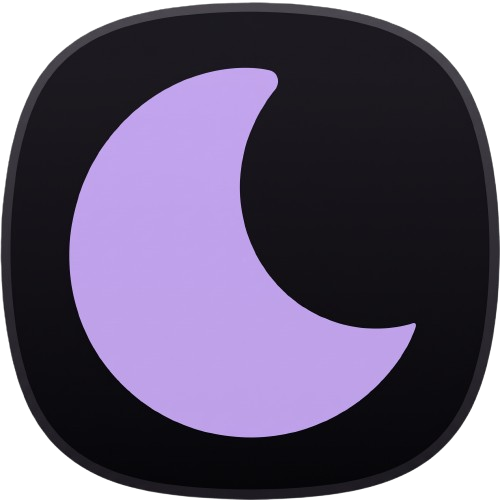

<div align="center">

# <picture></picture> ScreenShade

An open-source application designed for screen protection and management on automotive units and Android devices.

<br>

<table align="center" border="0" cellspacing="0" cellpadding="10">
  <tr>
    <td align="center" valign="middle">
      <a href="URL_GOOGLE_PLAY">
        
      </a>
    </td>
    <td align="center" valign="middle">
      <a href="URL_FDROID">
        
      </a>
    </td>
    <td align="center" valign="middle">
      <a href="https://github.com/Harvest-Code/ScreenShade/releases">
        
      </a>
    </td>
    <td align="center" valign="middle">
      <a href="https://ko-fi.com/harvestcode">
        
      </a>
    </td>
  </tr>
</table>

<br>

[](LICENSE)
[](https://developer.android.com)
[](PRIVACY.md)
[](https://ko-fi.com/harvestcode)

<br>

<table align="center" border="0" cellspacing="0" cellpadding="0">
  <tr>
    <td align="center" valign="middle">
      
    </td>
  </tr>
</table>

</div>

---

**ScreenShade** is a privacy-first, 100% offline Android and Automotive utility designed to dim your display luminescence below hardware limits (*sub-zero software dimming*) and apply eye-strain reducing chromatic color filters. Optimized for night driving, car infotainment head units, and dark environment reading.

---

## ✨ Features

- **Sub-Zero Software Dimming:** Extends display darkness beyond minimum hardware brightness levels (up to 85% opacity veil) using a non-interactive, transparent software overlay.
- **Eye-Rest Chromatic Filters:**
  * **Warm:** Filters harsh blue-light spectrum to reduce eye strain.
  * **Sepia:** Soft golden hue ideal for long reading sessions.
  * **Monochrome:** High-contrast Rec.709 grayscale color matrix for distraction-free nighttime view.
  * **Custom Night-Vision Amber:** Deep amber/red hue preserving scotopic night vision for drivers.
- **Astronomical NOAA Solar Engine:** 100% offline algorithm that calculates local sun elevation, sunrise, sunset, and civil twilight using system RTC time and stored coordinates. Automatically adjusts shade depth without ever contacting external weather or ephemeris servers.
- **Car MCU & Head-Unit Deep Sleep Wakeup:** Listens for proprietary automotive fast-boot and deep-sleep wakeup broadcasts from popular Android car head-unit platforms (Allwinner/Autochips, Topway/TS, Microntek/MTC, FYT, Joying/SYU, Zjinnova) to seamlessly restore the overlay on engine start.
- **Direct Boot & Anti-Kill Watchdog:** Stores settings in Android Device Protected (DE) storage for instant accessibility during locked/cold boot. A native periodic JobService watchdog revives the service if the automotive MCU kills background processes during deep standby.
- **Secure Automation & Broadcast API:** Control ScreenShade programmatically via Tasker, MacroDroid, or ADB shell broadcasts with built-in user gate toggle and anti-blackout hard clamping.
- **Fail-Safe Emergency Notification:** Persistent foreground service notification with a single-tap instant stop button in the notification drawer.
- **100% Offline & Zero Telemetry:** Contains **zero** network permissions, zero third-party SDKs, zero analytics, and zero tracking.

---

## 🔒 Safety & Legal Disclaimer

> [!WARNING]
> **CRITICAL ROAD SAFETY WARNING:**
> This application is provided **"AS IS"**, without warranty of any kind, express or implied, to the maximum extent permitted by applicable law (including Art. 1229 of the Italian Civil Code).
> 
> * **NO IN-MOTION INTERACTION:** Interacting with the user interface, adjusting sliders, or changing settings while operating a moving vehicle is strictly prohibited.
> * **VERIFY ADAS & INSTRUMENT VISIBILITY:** Before driving, the operator is strictly required to verify in safe, stationary conditions that the screen dimming level and color filter do not impair the visibility of dashboard instruments, warning lamps, speedometer, GPS navigation maps, or critical safety video streams such as backup/reversing cameras and Advanced Driver Assistance Systems (ADAS).
> * **EXCLUSIVE OPERATOR RESPONSIBILITY:** The driver assumes full and exclusive legal responsibility for operating the motor vehicle in compliance with traffic laws and road safety regulations. The developer disclaims any civil or criminal liability for traffic collisions, administrative fines, electronic or mechanical failures, or automotive head-unit malfunctions.

---

## 🛡️ Privacy & Permissions

ScreenShade operates **100% offline** and does **not** request `android.permission.INTERNET`.

| Permission | Technical Justification | Data Transmitted |
|---|---|---|
| `SYSTEM_ALERT_WINDOW` | Required to draw the dimming veil and chromatic color filter above other applications. | None |
| `RECEIVE_BOOT_COMPLETED` | Allows restoring the overlay automatically when Android boots or the car engine starts. | None |
| `FOREGROUND_SERVICE` / `FOREGROUND_SERVICE_SPECIAL_USE` | Keeps the dimming overlay active reliably in the background while other apps (e.g. navigation) run. | None |
| `POST_NOTIFICATIONS` | Displays the persistent status notification with the emergency 1-tap fail-safe stop button. | None |
| `ACCESS_COARSE_LOCATION` | Optional. Used solely upon explicit user request to approximate local latitude and longitude for offline sunrise/sunset calculations. | None (stored strictly in local `SharedPreferences`, never leaves the device). |

Local backup (`android:allowBackup="false"`) is disabled to prevent extraction of user settings or coordinates via ADB or cloud services.

---

## 🤖 Broadcast API & Automation

External automation is **disabled by default** for road and device safety. To enable it, open the **Automation & API** dialog from the toolbar menu and turn on the **Enable External Automation** toggle.

All brightness values are strictly clamped (`0.0f` to `0.85f`) to prevent malicious or accidental screen blackouts.

```bash
# Toggle shade on/off
adb shell am broadcast -a com.screenshade.ACTION_TOGGLE

# Start shade
adb shell am broadcast -a com.screenshade.ACTION_START

# Stop shade
adb shell am broadcast -a com.screenshade.ACTION_STOP

# Set brightness opacity (safe range: 0.00 to 0.85)
adb shell am broadcast -a com.screenshade.ACTION_SET_BRIGHTNESS --ef brightness 0.45

# Set chromatic filter mode (WARM, SEPIA, MONO, CUSTOM, NONE)
adb shell am broadcast -a com.screenshade.ACTION_SET_FILTER --es filter WARM
```

---

## 🏗️ Building from Source

ScreenShade is configured with two distinct product flavors to comply with open-source and commercial repository policies:

- **`fdroid` Flavor:** Pure FOSS build. Compliant with F-Droid inclusion guidelines (`dependenciesInfo` stripped, no Google proprietary metadata). Includes optional voluntary Ko-fi support button.
- **`play` Flavor:** Compliant with Google Play Store Policies. Completely hides and disables all out-of-app donation buttons and external funding links (`BuildConfig.ENABLE_DONATIONS = false`).

### Prerequisites

- JDK 17
- Android SDK Platform 34
- Android Gradle Plugin 8.3.2+

### Commands

```bash
# Build F-Droid / GitHub FOSS release APK
./gradlew assembleFdroidRelease

# Build Google Play Store release APK/Bundle
./gradlew assemblePlayRelease
./gradlew bundlePlayRelease

# Debug builds
./gradlew assembleFdroidDebug
./gradlew assemblePlayDebug
```

---

## ☕ Support the Project

ScreenShade is completely free and libre software licensed under the GNU General Public License v3.0.

If you find this application helpful during nighttime road trips or on your automotive display, consider supporting independent development time with a voluntary coffee:

<p align="center">
  <a href="https://ko-fi.com/harvestcode">
    
  </a>
</p>

*(Voluntary contributions are spontaneous modest gifts to support open-source work; no additional features, commercial services, or warranties are provided in exchange).*

---

## 📄 License

This project is licensed under the GNU General Public License v3.0 (GPLv3). See the [LICENSE](LICENSE) file for the full license text.
